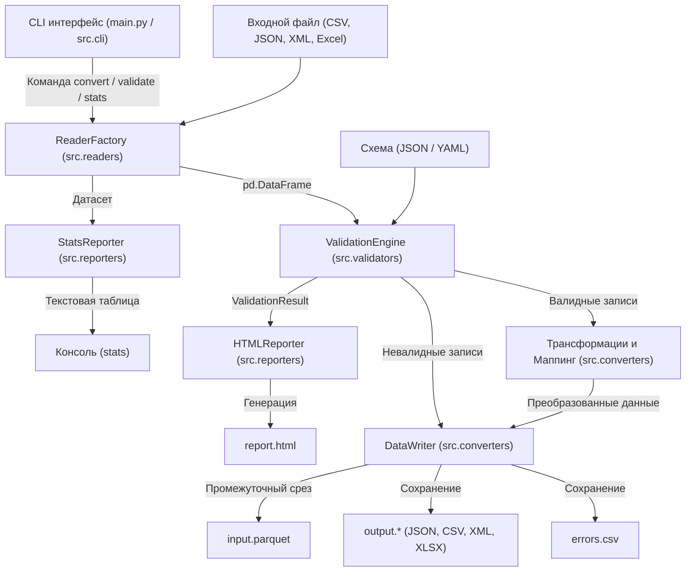

# Архитектура системы: DataBridge

## 1. Концепция и архитектурный стиль
DataBridge спроектирован по модульному конвейерному принципу (Pipes & Filters) с использованием паттернов проектирования:
- **Factory Method** (`ReaderFactory`) для полиморфного создания ридеров входных форматов.
- **Strategy** для подключаемых правил валидации и функций трансформации.
- **Pipeline** (`ConversionPipeline`) для управления последовательностью этапов ETL.

---

## 2. Диаграмма взаимодействия компонентов



---

## 3. Модульная структура пакетов

```text
src/
├── cli/                 # Интерфейс командной строки
│   ├── parser.py        # Конфигурация аргументов argparse
│   ├── commands.py      # Обработчики команд convert, validate, stats
│   └── __init__.py      # Точка входа в CLI
├── readers/             # Модули чтения данных
│   ├── base.py          # Абстрактный базовый класс BaseReader
│   ├── csv_reader.py    # Чтение CSV с авто-разделителем
│   ├── json_reader.py   # Чтение JSON (массив объектов)
│   ├── xml_reader.py    # Чтение XML (плоские теги)
│   ├── excel_reader.py  # Чтение Excel (.xlsx и .xls)
│   ├── factory.py       # ReaderFactory (выбор ридера по расширению)
│   └── __init__.py
├── validators/          # Модули проверки корректности
│   ├── schema.py        # Загрузка и разбор схемы (JSON / YAML)
│   ├── rules.py         # Реализация правил (required, type, range, unique, etc.)
│   ├── engine.py        # ValidationEngine и ValidationResult
│   └── __init__.py
├── converters/          # Конвейер конвертации и трансформации
│   ├── transformers.py  # Функции трансформации (trim, case, date, replace) и маппинг
│   ├── writers.py       # DataWriter (запись в CSV, JSON, XML, XLSX, Parquet)
│   ├── pipeline.py      # ConversionPipeline (оркестрация процесса)
│   └── __init__.py
├── reporters/           # Модули генерации отчётов
│   ├── html_reporter.py # Генератор HTML-отчёта с метриками и таблицей ошибок
│   ├── stats_reporter.py# Профилировщик датасетов (статистика по колонкам)
│   └── __init__.py
└── models.py            # Модель валидации дескриптора входного файла
```

---

## 4. Пайплайн обработки данных

1. **Инициализация**: CLI разбирает переданные параметры командной строки.
2. **Экстракция (Extract)**: `ReaderFactory` анализирует расширение пути, инстанцирует специализированный ридер и загружает данные в `pd.DataFrame`.
3. **Валидация (Validate)**: `ValidationEngine` применяет правила из схемы построчно, формирует списки индексов валидных и невалидных строк.
4. **Сепарация**:
   - Невалидные строки извлекаются и передаются в `DataWriter` для сохранения в `errors.csv`.
   - Валидные строки передаются далее по конвейеру.
5. **Трансформация (Transform)**:
   - К валидным данным применяются правила `transform` (обрезка пробелов, приведение регистра, вычисление даты из timestamp, замена по словарю).
   - Выполняется сохранение промежуточного состояния в `data/processed/*.parquet`.
   - Применяется маппинг колонок `target_name`.
6. **Загрузка (Load)**: Результирующий датасет сериализуется в целевой формат (`DataWriter`).
7. **Отчётность (Report)**:
   - Формируется консольный вывод с разбивкой по ошибкам.
   - При наличии ключа `--report` формируется автономный `report.html`.
